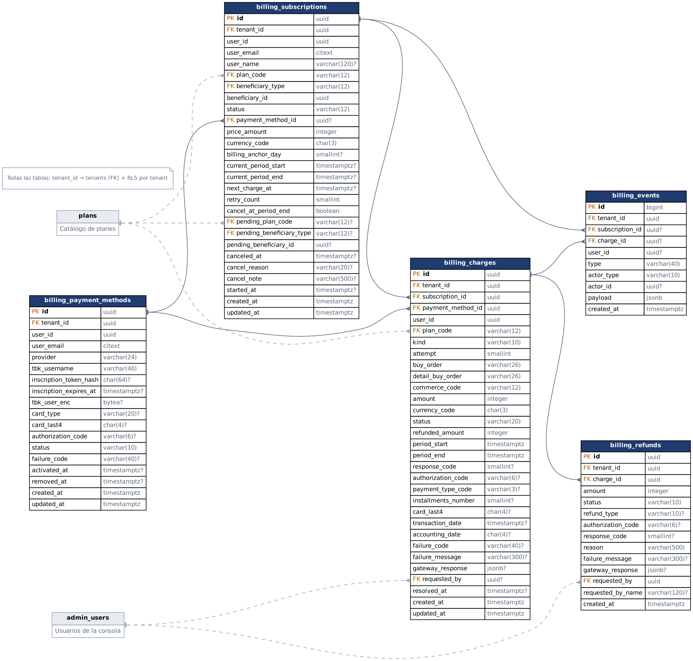

# Modelo físico de datos · Pasarela de pago y suscripciones

> Generado desde el catálogo de PostgreSQL 16.15 (Ubuntu 16.15-0ubuntu0.24.04.1) con `python -m scripts.gen_db_doc` después de aplicar `db/agecare_admin_ddl.sql` + `db/agecare_billing_ddl.sql`. Describe exactamente lo que crea el DDL.

## Diagrama

Flechas: relación 1 → N (pata de gallo en el lado N). En gris punteado, tablas del resto de la consola (`plans`, `admin_users`); la FK `tenant_id → tenants` de todas las tablas no se dibuja para no recargar el diagrama. `?` = columna que admite NULL. Versión vectorial: `bd_facturacion.svg`; fuente Graphviz: `bd_facturacion.dot`. El modelo completo de la consola (55 tablas) está en `db/agecare_admin.dbml` (se importa en dbdiagram.io).

## Resumen

| Tabla | Propósito | Filas por… |
|---|---|---|
| `billing_payment_methods` | Tarjeta inscrita en Oneclick (tbk_user cifrado, tipo y últimos 4) | inscripción |
| `billing_subscriptions` | Suscripción mensual a un plan, su estado y periodo pagado | beneficiario y plan |
| `billing_charges` | Cada intento de cobro a Transbank | intento |
| `billing_refunds` | Reembolsos pedidos desde la consola (inmutable) | reembolso |
| `billing_events` | Bitácora inmutable del ciclo de vida | evento |
| `billing_subscription_transitions` | Catálogo de cambios de estado permitidos | transición |
| `*_history` | Copia de cada versión de la fila (auditoría) | cambio |

**Total:** 9 tablas, 33 índices. Todas en el esquema `admin`, con `tenant_id` y RLS por tenant (`admin.current_tenant_id()`).

## Reglas que garantiza la base de datos

- **Una tarjeta activa por usuario:** índice único parcial `billing_pm_one_active_uq` (`WHERE status = 'active'`).
- **Una suscripción vigente por beneficiario:** `billing_sub_one_live_uq` (estados incomplete/active/past_due).
- **Nunca dos cobros en curso para la misma suscripción:** `billing_charges_one_inflight_uq` (`WHERE status IN ('pending','unknown')`). Junto con `SELECT … FOR UPDATE SKIP LOCKED` en el job, evita el doble cobro.
- **Órdenes de compra únicas** (`buy_order`, `detail_buy_order`): Transbank exige que no se repitan.
- **Estados válidos:** el trigger de transición rechaza, por ejemplo, `canceled → active`.
- **Montos coherentes:** CHECK `amount > 0` y `0 ≤ refunded_amount ≤ amount`; el estado `refunded` exige reembolso total y `partially_refunded` uno parcial; un cobro aprobado exige `response_code = 0` y código de autorización. El trigger `trg_refund_apply` valida la suma de reembolsos bajo bloqueo.
- **Inmutabilidad:** `billing_refunds`, `billing_events` y las tablas `*_history` no admiten UPDATE ni DELETE.
- **Datos sensibles:** no se guarda el número de tarjeta; `tbk_user` va cifrado (Fernet) y el historial lo deja en NULL.

## Índices y para qué sirven

| Índice | Consulta que acelera |
|---|---|
| `billing_sub_due_idx` (parcial) | Job: suscripciones a renovar o reintentar (`next_charge_at`) |
| `billing_charges_unresolved_idx` (parcial) | Job: cobros `pending/unknown` por conciliar |
| `billing_pm_pending_idx` (parcial) | Job: inscripciones abandonadas que expiran |
| `billing_sub_status_idx`, `billing_sub_plan_idx` | Consola: filtros por estado/plan y KPIs (MRR, mezcla de planes) |
| `billing_sub_search_idx` (GIN trigram) | Consola: búsqueda por correo o nombre |
| `billing_charges_status_idx`, `billing_charges_created_idx` | Consola: listado de cobros y tasa de aprobación |
| `billing_charges_sub_idx`, `billing_events_sub_idx` | Detalle de una suscripción (cobros y eventos) |
| `billing_refunds_charge_idx` | Detalle de un cobro (reembolsos) |
| `billing_pm_user_idx`, `billing_sub_user_idx` | App: `GET /me` del usuario |

## Tablas

### billing_payment_methods

Tarjetas inscritas en Transbank Oneclick Mall. Sin datos de tarjeta salvo tipo y últimos 4 dígitos. Historial en billing_payment_methods_history (sin tbk_user_enc ni hash del token).

| Columna | Tipo | Nulo | Por defecto | Clave | Descripción |
|---|---|---|---|---|---|
| `id` | uuid | no | `gen_random_uuid()` | PK |  |
| `tenant_id` | uuid | no |  | FK → tenants |  |
| `user_id` | uuid | no |  |  | Referencia lógica a app.users.id (pagador). |
| `user_email` | citext | no |  |  |  |
| `provider` | varchar(24) | no | `'transbank_oneclick'::character varying` |  |  |
| `tbk_username` | varchar(40) | no |  |  | username enviado a Transbank (≤ 40). Debe repetirse en cada cobro y al eliminar la inscripción. |
| `inscription_token_hash` | char(64) | sí |  |  | SHA-256 del TBK_TOKEN de la inscripción: permite ubicarla en el retorno de Webpay sin guardar el token. |
| `inscription_expires_at` | timestamptz | sí |  |  |  |
| `tbk_user_enc` | bytea | sí |  |  | tbk_user cifrado en aplicación (Fernet, llave en Key Vault). Nunca en claro. |
| `card_type` | varchar(20) | sí |  |  |  |
| `card_last4` | char(4) | sí |  |  |  |
| `authorization_code` | varchar(6) | sí |  |  |  |
| `status` | varchar(10) | no | `'pending'::character varying` |  |  |
| `failure_code` | varchar(40) | sí |  |  |  |
| `activated_at` | timestamptz | sí |  |  |  |
| `removed_at` | timestamptz | sí |  |  |  |
| `created_at` | timestamptz | no | `now()` |  |  |
| `updated_at` | timestamptz | no | `now()` |  |  |

**Restricciones**

| Nombre | Tipo | Definición |
|---|---|---|
| `billing_payment_methods_card_last4_check` | CHECK | `CHECK ((card_last4 ~ '^[0-9]{4}$'::text))` |
| `billing_payment_methods_provider_check` | CHECK | `CHECK (((provider)::text = ANY ((ARRAY['transbank_oneclick'::character varying, 'fake'::character varying])::text[])))` |
| `billing_payment_methods_status_check` | CHECK | `CHECK (((status)::text = ANY ((ARRAY['pending'::character varying, 'active'::character varying, 'failed'::character varying, 'aborted'::character varying, 'removed'::character varying])::text[])))` |
| `billing_pm_active_ck` | CHECK | `CHECK ((((status)::text <> 'active'::text) OR ((tbk_user_enc IS NOT NULL) AND (card_last4 IS NOT NULL) AND (activated_at IS NOT NULL))))` |
| `billing_pm_failed_ck` | CHECK | `CHECK ((((status)::text <> ALL ((ARRAY['failed'::character varying, 'aborted'::character varying])::text[])) OR (failure_code IS NOT NULL)))` |
| `billing_pm_removed_ck` | CHECK | `CHECK ((((status)::text = 'removed'::text) = (removed_at IS NOT NULL)))` |
| `billing_payment_methods_tenant_id_fkey` | FOREIGN KEY | `FOREIGN KEY (tenant_id) REFERENCES admin.tenants(id)` |
| `billing_payment_methods_inscription_token_hash_key` | UNIQUE | `UNIQUE (inscription_token_hash)` |

**Índices**

| Índice | Tipo | Definición |
|---|---|---|
| `billing_payment_methods_pkey` | PK | `USING btree (id)` |
| `billing_payment_methods_inscription_token_hash_key` | UNIQUE | `USING btree (inscription_token_hash)` |
| `billing_pm_one_active_uq` | UNIQUE parcial | `USING btree (tenant_id, user_id) WHERE ((status)::text = 'active'::text)` |
| `billing_pm_pending_idx` | índice parcial | `USING btree (inscription_expires_at) WHERE ((status)::text = 'pending'::text)` |
| `billing_pm_user_idx` | índice | `USING btree (tenant_id, user_id, created_at DESC)` |

**Triggers**

| Trigger | Función | Qué hace |
|---|---|---|
| `trg_history` | `tg_write_history()` | Después de cada INSERT/UPDATE/DELETE guarda una copia de la fila en la tabla `*_history`, con los secretos en NULL. |
| `trg_updated_at` | `tg_set_updated_at()` | Actualiza `updated_at` en cada UPDATE. |

**Seguridad por fila (RLS):** activa · políticas: tenant_isolation.

### billing_subscriptions

Suscripciones mensuales a planes de pago (Dorado por usuario, Platino por familia, Proveedor por proveedor). Fuente de MRR y de la mezcla de planes. Historial en billing_subscriptions_history.

| Columna | Tipo | Nulo | Por defecto | Clave | Descripción |
|---|---|---|---|---|---|
| `id` | uuid | no | `gen_random_uuid()` | PK |  |
| `tenant_id` | uuid | no |  | FK → tenants |  |
| `user_id` | uuid | no |  |  |  |
| `user_email` | citext | no |  |  |  |
| `user_name` | varchar(120) | sí |  |  |  |
| `plan_code` | varchar(12) | no |  | FK → plans |  |
| `beneficiary_type` | varchar(12) | no |  | FK → plans |  |
| `beneficiary_id` | uuid | no |  |  | Referencia lógica a app.users / app.families / app.providers según beneficiary_type (= plans.billing_unit). |
| `status` | varchar(12) | no | `'incomplete'::character varying` |  |  |
| `payment_method_id` | uuid | sí |  | FK → billing_payment_methods |  |
| `price_amount` | integer | no |  |  | Precio mensual congelado al suscribirse (plan_prices). Los cambios de precio aplican a suscripciones nuevas. |
| `currency_code` | char(3) | no | `'CLP'::bpchar` |  |  |
| `billing_anchor_day` | smallint | sí |  |  | Día del mes del primer pago; los periodos siguientes se anclan a él (acotado al último día del mes). |
| `current_period_start` | timestamptz | sí |  |  |  |
| `current_period_end` | timestamptz | sí |  |  |  |
| `next_charge_at` | timestamptz | sí |  |  | Próximo intento de cobro: fin de periodo o fecha del reintento si está en mora. NULL si no se cobrará más. |
| `retry_count` | smallint | no | `0` |  |  |
| `cancel_at_period_end` | boolean | no | `false` |  |  |
| `pending_plan_code` | varchar(12) | sí |  | FK → plans |  |
| `pending_beneficiary_type` | varchar(12) | sí |  | FK → plans |  |
| `pending_beneficiary_id` | uuid | sí |  |  |  |
| `canceled_at` | timestamptz | sí |  |  |  |
| `cancel_reason` | varchar(20) | sí |  |  |  |
| `cancel_note` | varchar(500) | sí |  |  |  |
| `started_at` | timestamptz | sí |  |  |  |
| `created_at` | timestamptz | no | `now()` |  |  |
| `updated_at` | timestamptz | no | `now()` |  |  |

**Restricciones**

| Nombre | Tipo | Definición |
|---|---|---|
| `billing_sub_canceled_ck` | CHECK | `CHECK ((((status)::text = 'canceled'::text) = ((canceled_at IS NOT NULL) AND (cancel_reason IS NOT NULL))))` |
| `billing_sub_live_ck` | CHECK | `CHECK ((((status)::text <> ALL ((ARRAY['active'::character varying, 'past_due'::character varying])::text[])) OR ((payment_method_id IS NOT NULL) AND (current_period_start IS NOT NULL) AND (current_period_end IS NOT NULL) AND (billing_anchor_day IS NOT NULL) AND (started_at IS NOT NULL))))` |
| `billing_sub_pending_ck` | CHECK | `CHECK ((((pending_plan_code IS NULL) = (pending_beneficiary_type IS NULL)) AND ((pending_plan_code IS NULL) = (pending_beneficiary_id IS NULL))))` |
| `billing_sub_period_ck` | CHECK | `CHECK (((current_period_end IS NULL) OR (current_period_end > current_period_start)))` |
| `billing_sub_retry_ck` | CHECK | `CHECK ((((status)::text = 'past_due'::text) OR (retry_count = 0)))` |
| `billing_subscriptions_billing_anchor_day_check` | CHECK | `CHECK (((billing_anchor_day >= 1) AND (billing_anchor_day <= 31)))` |
| `billing_subscriptions_cancel_reason_check` | CHECK | `CHECK (((cancel_reason)::text = ANY ((ARRAY['user_request'::character varying, 'payment_failed'::character varying, 'admin'::character varying, 'fraud'::character varying, 'plan_change'::character varying])::text[])))` |
| `billing_subscriptions_pending_plan_code_check` | CHECK | `CHECK (((pending_plan_code)::text <> 'free'::text))` |
| `billing_subscriptions_plan_code_check` | CHECK | `CHECK (((plan_code)::text <> 'free'::text))` |
| `billing_subscriptions_price_amount_check` | CHECK | `CHECK ((price_amount > 0))` |
| `billing_subscriptions_retry_count_check` | CHECK | `CHECK (((retry_count >= 0) AND (retry_count <= 6)))` |
| `billing_subscriptions_status_check` | CHECK | `CHECK (((status)::text = ANY ((ARRAY['incomplete'::character varying, 'active'::character varying, 'past_due'::character varying, 'canceled'::character varying, 'expired'::character varying])::text[])))` |
| `billing_sub_pending_plan_fk` | FOREIGN KEY | `FOREIGN KEY (pending_plan_code, pending_beneficiary_type) REFERENCES admin.plans(code, billing_unit)` |
| `billing_sub_plan_fk` | FOREIGN KEY | `FOREIGN KEY (plan_code, beneficiary_type) REFERENCES admin.plans(code, billing_unit)` |
| `billing_subscriptions_payment_method_id_fkey` | FOREIGN KEY | `FOREIGN KEY (payment_method_id) REFERENCES admin.billing_payment_methods(id)` |
| `billing_subscriptions_tenant_id_fkey` | FOREIGN KEY | `FOREIGN KEY (tenant_id) REFERENCES admin.tenants(id)` |

**Índices**

| Índice | Tipo | Definición |
|---|---|---|
| `billing_subscriptions_pkey` | PK | `USING btree (id)` |
| `billing_sub_due_idx` | índice parcial | `USING btree (next_charge_at) WHERE ((status)::text = ANY ((ARRAY['active'::character varying, 'past_due'::character varying])::text[]))` |
| `billing_sub_one_live_uq` | UNIQUE parcial | `USING btree (tenant_id, beneficiary_type, beneficiary_id) WHERE ((status)::text = ANY ((ARRAY['incomplete'::character varying, 'active'::character varying, 'past_due'::character varying])::text[]))` |
| `billing_sub_plan_idx` | índice | `USING btree (tenant_id, plan_code, status)` |
| `billing_sub_search_idx` | índice | `USING gin (((((user_email)::text \|\| ' '::text) \|\| (COALESCE(user_name, ''::character varying))::text)) gin_trgm_ops)` |
| `billing_sub_status_idx` | índice | `USING btree (tenant_id, status, created_at DESC)` |
| `billing_sub_user_idx` | índice | `USING btree (tenant_id, user_id)` |

**Triggers**

| Trigger | Función | Qué hace |
|---|---|---|
| `trg_history` | `tg_write_history()` | Después de cada INSERT/UPDATE/DELETE guarda una copia de la fila en la tabla `*_history`, con los secretos en NULL. |
| `trg_transition` | `tg_billing_subscription_transition()` | Rechaza cambios de `status` que no estén en `billing_subscription_transitions`. |
| `trg_updated_at` | `tg_set_updated_at()` | Actualiza `updated_at` en cada UPDATE. |

**Seguridad por fila (RLS):** activa · políticas: tenant_isolation.

### billing_charges

Cada intento de cobro a Transbank (una transacción Oneclick Mall con un detalle). Se inserta en pending ANTES de llamar a Transbank; si la llamada no responde queda unknown y el job la concilia con GET /transactions/{buy_order}.

| Columna | Tipo | Nulo | Por defecto | Clave | Descripción |
|---|---|---|---|---|---|
| `id` | uuid | no | `gen_random_uuid()` | PK |  |
| `tenant_id` | uuid | no |  | FK → tenants |  |
| `subscription_id` | uuid | no |  | FK → billing_subscriptions |  |
| `payment_method_id` | uuid | no |  | FK → billing_payment_methods |  |
| `user_id` | uuid | no |  |  |  |
| `plan_code` | varchar(12) | no |  | FK → plans |  |
| `kind` | varchar(10) | no |  |  |  |
| `attempt` | smallint | no | `1` |  |  |
| `buy_order` | varchar(26) | no |  |  | Orden de compra del mall (≤ 26). Única: Transbank la usa para consultar estado y reembolsar. |
| `detail_buy_order` | varchar(26) | no |  |  |  |
| `commerce_code` | varchar(12) | no |  |  |  |
| `amount` | integer | no |  |  |  |
| `currency_code` | char(3) | no | `'CLP'::bpchar` |  |  |
| `status` | varchar(20) | no | `'pending'::character varying` |  |  |
| `refunded_amount` | integer | no | `0` |  |  |
| `period_start` | timestamptz | no |  |  |  |
| `period_end` | timestamptz | no |  |  |  |
| `response_code` | smallint | sí |  |  |  |
| `authorization_code` | varchar(6) | sí |  |  |  |
| `payment_type_code` | varchar(3) | sí |  |  |  |
| `installments_number` | smallint | sí |  |  |  |
| `card_last4` | char(4) | sí |  |  |  |
| `transaction_date` | timestamptz | sí |  |  |  |
| `accounting_date` | char(4) | sí |  |  |  |
| `failure_code` | varchar(40) | sí |  |  |  |
| `failure_message` | varchar(300) | sí |  |  |  |
| `gateway_response` | jsonb | sí |  |  | Respuesta de Transbank saneada (sin tbk_user). Evidencia ante contracargos. |
| `requested_by` | uuid | sí |  | FK → admin_users |  |
| `resolved_at` | timestamptz | sí |  |  |  |
| `created_at` | timestamptz | no | `now()` |  |  |
| `updated_at` | timestamptz | no | `now()` |  |  |

**Restricciones**

| Nombre | Tipo | Definición |
|---|---|---|
| `billing_charge_failed_ck` | CHECK | `CHECK ((((status)::text <> 'failed'::text) OR ((failure_code IS NOT NULL) AND (resolved_at IS NOT NULL))))` |
| `billing_charge_manual_ck` | CHECK | `CHECK ((((kind)::text <> 'manual'::text) OR (requested_by IS NOT NULL)))` |
| `billing_charge_paid_ck` | CHECK | `CHECK ((((status)::text <> ALL ((ARRAY['authorized'::character varying, 'refunded'::character varying, 'partially_refunded'::character varying])::text[])) OR ((response_code = 0) AND (authorization_code IS NOT NULL) AND (resolved_at IS NOT NULL))))` |
| `billing_charge_period_ck` | CHECK | `CHECK ((period_end > period_start))` |
| `billing_charge_refund_ck` | CHECK | `CHECK (((refunded_amount >= 0) AND (refunded_amount <= amount)))` |
| `billing_charge_refunded_ck` | CHECK | `CHECK (((((status)::text = 'refunded'::text) AND (refunded_amount = amount)) OR (((status)::text = 'partially_refunded'::text) AND (refunded_amount > 0) AND (refunded_amount < amount)) OR (((status)::text <> ALL ((ARRAY['refunded'::character varying, 'partially_refunded'::character varying])::text[])) AND (refunded_amount = 0))))` |
| `billing_charges_amount_check` | CHECK | `CHECK ((amount > 0))` |
| `billing_charges_attempt_check` | CHECK | `CHECK (((attempt >= 1) AND (attempt <= 7)))` |
| `billing_charges_buy_order_check` | CHECK | `CHECK (((buy_order)::text ~ '^[A-Za-z0-9-]{1,26}$'::text))` |
| `billing_charges_detail_buy_order_check` | CHECK | `CHECK (((detail_buy_order)::text ~ '^[A-Za-z0-9-]{1,26}$'::text))` |
| `billing_charges_kind_check` | CHECK | `CHECK (((kind)::text = ANY ((ARRAY['initial'::character varying, 'renewal'::character varying, 'retry'::character varying, 'manual'::character varying])::text[])))` |
| `billing_charges_status_check` | CHECK | `CHECK (((status)::text = ANY ((ARRAY['pending'::character varying, 'authorized'::character varying, 'failed'::character varying, 'unknown'::character varying, 'refunded'::character varying, 'partially_refunded'::character varying])::text[])))` |
| `billing_charges_payment_method_id_fkey` | FOREIGN KEY | `FOREIGN KEY (payment_method_id) REFERENCES admin.billing_payment_methods(id)` |
| `billing_charges_plan_code_fkey` | FOREIGN KEY | `FOREIGN KEY (plan_code) REFERENCES admin.plans(code)` |
| `billing_charges_requested_by_fkey` | FOREIGN KEY | `FOREIGN KEY (requested_by) REFERENCES admin.admin_users(id)` |
| `billing_charges_subscription_id_fkey` | FOREIGN KEY | `FOREIGN KEY (subscription_id) REFERENCES admin.billing_subscriptions(id)` |
| `billing_charges_tenant_id_fkey` | FOREIGN KEY | `FOREIGN KEY (tenant_id) REFERENCES admin.tenants(id)` |
| `billing_charges_buy_order_key` | UNIQUE | `UNIQUE (buy_order)` |
| `billing_charges_detail_buy_order_key` | UNIQUE | `UNIQUE (detail_buy_order)` |

**Índices**

| Índice | Tipo | Definición |
|---|---|---|
| `billing_charges_pkey` | PK | `USING btree (id)` |
| `billing_charges_buy_order_key` | UNIQUE | `USING btree (buy_order)` |
| `billing_charges_created_idx` | índice | `USING btree (tenant_id, created_at DESC)` |
| `billing_charges_detail_buy_order_key` | UNIQUE | `USING btree (detail_buy_order)` |
| `billing_charges_one_inflight_uq` | UNIQUE parcial | `USING btree (subscription_id) WHERE ((status)::text = ANY ((ARRAY['pending'::character varying, 'unknown'::character varying])::text[]))` |
| `billing_charges_status_idx` | índice | `USING btree (tenant_id, status, created_at DESC)` |
| `billing_charges_sub_idx` | índice | `USING btree (subscription_id, created_at DESC)` |
| `billing_charges_unresolved_idx` | índice parcial | `USING btree (created_at) WHERE ((status)::text = ANY ((ARRAY['pending'::character varying, 'unknown'::character varying])::text[]))` |

**Triggers**

| Trigger | Función | Qué hace |
|---|---|---|
| `trg_guard` | `tg_billing_charge_guard()` | Orden de compra, monto, suscripción y comercio son inmutables; un cobro resuelto no vuelve a pending/unknown y uno rechazado no cambia de estado. |
| `trg_history` | `tg_write_history()` | Después de cada INSERT/UPDATE/DELETE guarda una copia de la fila en la tabla `*_history`, con los secretos en NULL. |
| `trg_updated_at` | `tg_set_updated_at()` | Actualiza `updated_at` en cada UPDATE. |

**Seguridad por fila (RLS):** activa · políticas: tenant_isolation.

### billing_refunds

Reembolsos solicitados desde la consola (solo rol admin). Inmutable: un reembolso fallido se registra y se vuelve a intentar con una fila nueva.

| Columna | Tipo | Nulo | Por defecto | Clave | Descripción |
|---|---|---|---|---|---|
| `id` | uuid | no | `gen_random_uuid()` | PK |  |
| `tenant_id` | uuid | no |  | FK → tenants |  |
| `charge_id` | uuid | no |  | FK → billing_charges |  |
| `amount` | integer | no |  |  |  |
| `status` | varchar(10) | no |  |  |  |
| `refund_type` | varchar(10) | sí |  |  |  |
| `authorization_code` | varchar(6) | sí |  |  |  |
| `response_code` | smallint | sí |  |  |  |
| `reason` | varchar(500) | no |  |  |  |
| `failure_message` | varchar(300) | sí |  |  |  |
| `gateway_response` | jsonb | sí |  |  |  |
| `requested_by` | uuid | no |  | FK → admin_users |  |
| `requested_by_name` | varchar(120) | sí |  |  |  |
| `created_at` | timestamptz | no | `now()` |  |  |

**Restricciones**

| Nombre | Tipo | Definición |
|---|---|---|
| `billing_refund_failed_ck` | CHECK | `CHECK ((((status)::text <> 'failed'::text) OR (failure_message IS NOT NULL)))` |
| `billing_refund_ok_ck` | CHECK | `CHECK ((((status)::text <> 'succeeded'::text) OR (refund_type IS NOT NULL)))` |
| `billing_refunds_amount_check` | CHECK | `CHECK ((amount > 0))` |
| `billing_refunds_reason_check` | CHECK | `CHECK ((length((reason)::text) >= 5))` |
| `billing_refunds_refund_type_check` | CHECK | `CHECK (((refund_type)::text = ANY ((ARRAY['REVERSED'::character varying, 'NULLIFIED'::character varying])::text[])))` |
| `billing_refunds_status_check` | CHECK | `CHECK (((status)::text = ANY ((ARRAY['succeeded'::character varying, 'failed'::character varying])::text[])))` |
| `billing_refunds_charge_id_fkey` | FOREIGN KEY | `FOREIGN KEY (charge_id) REFERENCES admin.billing_charges(id)` |
| `billing_refunds_requested_by_fkey` | FOREIGN KEY | `FOREIGN KEY (requested_by) REFERENCES admin.admin_users(id)` |
| `billing_refunds_tenant_id_fkey` | FOREIGN KEY | `FOREIGN KEY (tenant_id) REFERENCES admin.tenants(id)` |

**Índices**

| Índice | Tipo | Definición |
|---|---|---|
| `billing_refunds_pkey` | PK | `USING btree (id)` |
| `billing_refunds_charge_idx` | índice | `USING btree (charge_id, created_at)` |
| `billing_refunds_created_idx` | índice | `USING btree (tenant_id, created_at DESC)` |

**Triggers**

| Trigger | Función | Qué hace |
|---|---|---|
| `trg_immutable` | `tg_forbid_change()` | Tabla inmutable: rechaza UPDATE y DELETE. |
| `trg_refund_apply` | `tg_billing_refund_apply()` | Bloquea el cobro, exige que esté aprobado, valida que la suma de reembolsos no supere lo cobrado y actualiza `refunded_amount` y el estado del cobro. |

**Seguridad por fila (RLS):** activa · políticas: tenant_isolation.

### billing_events

Bitácora inmutable del ciclo de vida (subscription.activated, charge.failed, payment_method.removed…). La API de la app la consume para notificar al usuario.

| Columna | Tipo | Nulo | Por defecto | Clave | Descripción |
|---|---|---|---|---|---|
| `id` | bigint | no |  | PK |  |
| `tenant_id` | uuid | no |  | FK → tenants |  |
| `subscription_id` | uuid | sí |  | FK → billing_subscriptions |  |
| `charge_id` | uuid | sí |  | FK → billing_charges |  |
| `user_id` | uuid | sí |  |  |  |
| `type` | varchar(40) | no |  |  |  |
| `actor_type` | varchar(10) | no |  |  |  |
| `actor_id` | uuid | sí |  |  |  |
| `payload` | jsonb | no | `'{}'::jsonb` |  |  |
| `created_at` | timestamptz | no | `now()` |  |  |

**Restricciones**

| Nombre | Tipo | Definición |
|---|---|---|
| `billing_events_actor_ck` | CHECK | `CHECK ((((actor_type)::text = 'system'::text) OR (actor_id IS NOT NULL)))` |
| `billing_events_actor_type_check` | CHECK | `CHECK (((actor_type)::text = ANY ((ARRAY['user'::character varying, 'admin'::character varying, 'system'::character varying])::text[])))` |
| `billing_events_type_check` | CHECK | `CHECK (((type)::text ~ '^[a-z_]+\.[a-z_]+$'::text))` |
| `billing_events_charge_id_fkey` | FOREIGN KEY | `FOREIGN KEY (charge_id) REFERENCES admin.billing_charges(id)` |
| `billing_events_subscription_id_fkey` | FOREIGN KEY | `FOREIGN KEY (subscription_id) REFERENCES admin.billing_subscriptions(id)` |
| `billing_events_tenant_id_fkey` | FOREIGN KEY | `FOREIGN KEY (tenant_id) REFERENCES admin.tenants(id)` |

**Índices**

| Índice | Tipo | Definición |
|---|---|---|
| `billing_events_pkey` | PK | `USING btree (id)` |
| `billing_events_sub_idx` | índice | `USING btree (subscription_id, created_at)` |
| `billing_events_type_idx` | índice | `USING btree (tenant_id, type, created_at DESC)` |

**Triggers**

| Trigger | Función | Qué hace |
|---|---|---|
| `trg_immutable` | `tg_forbid_change()` | Tabla inmutable: rechaza UPDATE y DELETE. |

**Seguridad por fila (RLS):** activa · políticas: tenant_isolation.

### billing_subscription_transitions

Transiciones válidas de suscripción. El trigger tg_billing_subscription_transition rechaza cualquier otra.

| Columna | Tipo | Nulo | Por defecto | Clave | Descripción |
|---|---|---|---|---|---|
| `from_status` | varchar(12) | no |  | PK |  |
| `to_status` | varchar(12) | no |  | PK |  |

**Índices**

| Índice | Tipo | Definición |
|---|---|---|
| `billing_subscription_transitions_pkey` | PK | `USING btree (from_status, to_status)` |

## Tablas de historial

El trigger `trg_history` (AFTER INSERT, UPDATE o DELETE) guarda una copia de cada versión de la fila: las columnas de la tabla original más `history_id`, `op` (I/U/D), `changed_at` y `changed_by` (actor de la sesión). Los secretos (`tbk_user_enc`, `inscription_token_hash`) existen como columna pero se guardan siempre en NULL. Son inmutables.

- `billing_payment_methods_history` · 22 columnas · índices: `billing_payment_methods_history_pkey`, `billing_payment_methods_history_tenant_time_idx`
- `billing_subscriptions_history` · 31 columnas · índices: `billing_subscriptions_history_pkey`, `billing_subscriptions_history_tenant_time_idx`
- `billing_charges_history` · 35 columnas · índices: `billing_charges_history_pkey`, `billing_charges_history_tenant_time_idx`
